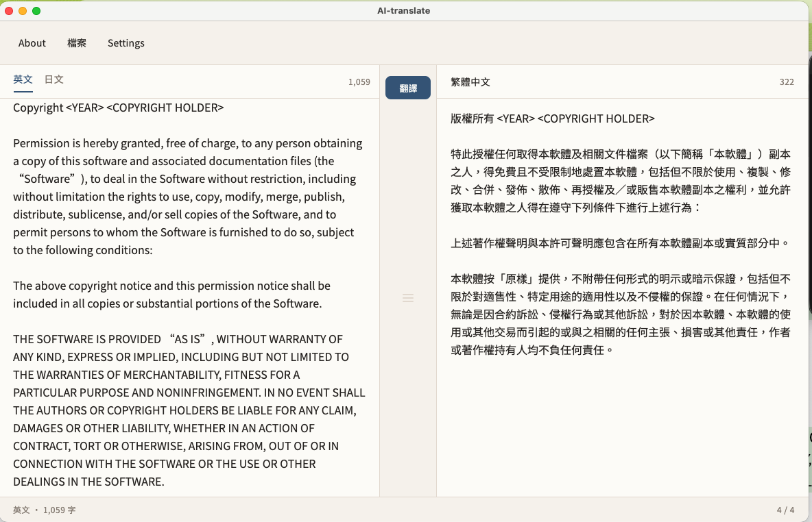
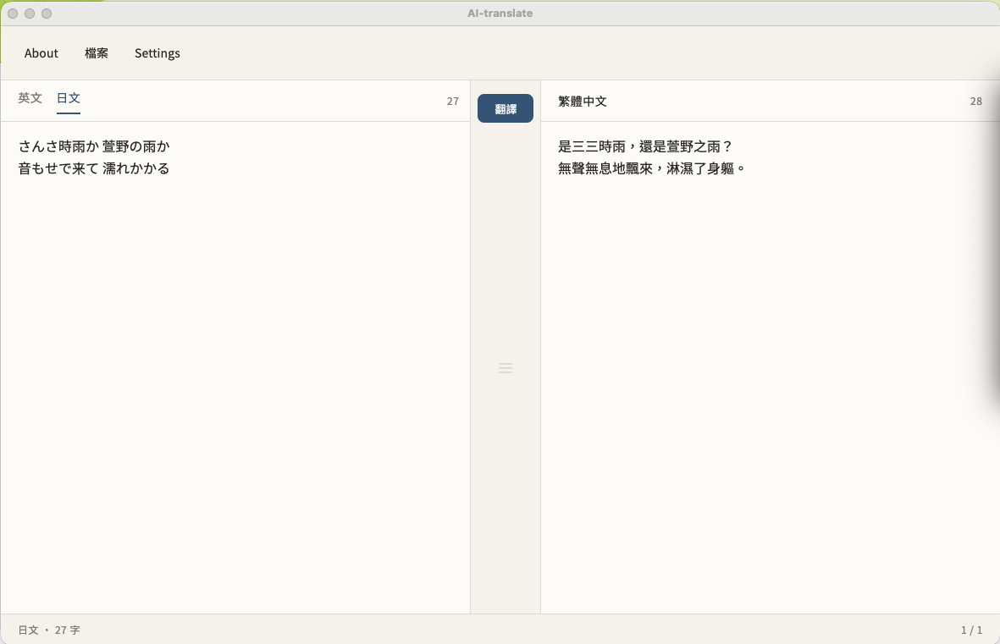
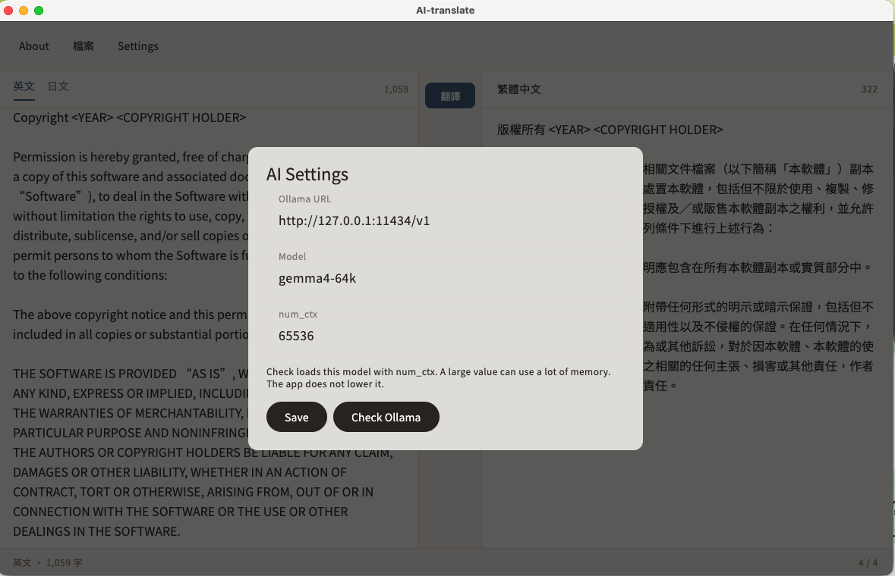

# AI-translate

把英文或日文譯成台灣使用的繁體中文。桌面版連到本機的 Ollama。版本 0.1.0。

這是 Kotlin Multiplatform 與 Compose Multiplatform 專案，目標是 Desktop（JVM 25）與 Wasm。

## 畫面

### 英譯中

左欄選「英文」。原文可以貼上，也可以從「檔案 → 載入」讀入。按下中間的「翻譯」，繁體中文出現在右欄。中間的分隔條可以左右拖。



### 日譯中

來源改選「日文」。譯文仍是繁體中文。



### AI 設定

桌面版從 Settings 打開 AI Settings，交給本機 Ollama 與已安裝的模型。圖中的模型是 Gemma4，名稱為 `gemma4-64k`。



預設位址是 `http://127.0.0.1:11434/v1`，`num_ctx` 是 `65536`。位址只接受 `127.0.0.1` 或 `localhost`。Check Ollama 會確認這個模型已經安裝，並用設定的 context 長度試載一次。較大的 `num_ctx` 會占用較多記憶體。

## 使用

1. 啟動 Ollama，並準備一個本機模型。Settings 裡的模型名稱要和 Ollama 的名稱一致。預設是 `gemma4-64k`。
2. 安裝 JDK 25。
3. 在專案根目錄執行：

```shell
./gradlew :composeApp:run
```

4. 打開 Settings → AI Settings，按 Save，再按 Check Ollama。
5. 在左欄貼上原文，或載入 UTF-8 文字檔。超過 100,000 字時，文末會被截掉。
6. 按「翻譯」。空行用來分段；一段超過 1,500 字時，再依句末切開，然後一段一段送出。
7. 「檔案 → 儲存」只存右欄譯文。右欄是空的時候不能存。若這次開過檔，預設檔名會加上 `.zh-Hant`，例如 `notes.md` 存成 `notes.zh-Hant.md`。

翻譯進行中可以按「停止」。停止或某一段失敗之後，只要原文和來源語言沒有再改，就可以按「繼續」。一經修改，下一次會整篇重翻，並換掉右欄。

送給模型的指令寫在 [`AI-commands/translate.md`](AI-commands/translate.md)，可以直接改。每一段的來回會另外寫進 `AI-commands/runs/`，這個目錄不進版本庫。送出之前，程式會從該次的檔案把命令讀回來。

## 網頁版

```shell
./gradlew :composeApp:wasmJsBrowserDevelopmentRun
```

網頁版可以載入、貼上、編輯，也可以把譯文下載下來。翻譯按鈕看得到，但是停用，狀態列寫「桌面版才能翻譯」。網頁版沒有 Settings。

## 測試

```shell
./gradlew :composeApp:desktopTest
```

改顯示名稱或版號時，見 [docs/programming/](docs/programming/)。
